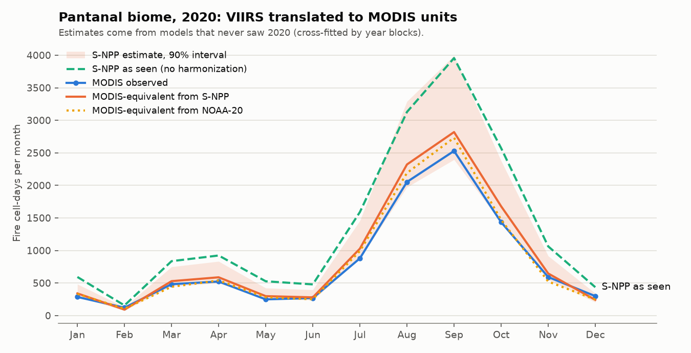
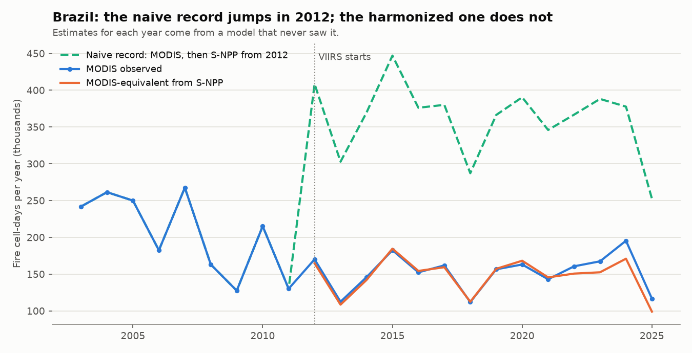

# Space Monkeys — Backend

NASA Space Apps Challenge: a **burning activity calendar** built from satellite-detected active fire hotspots.

The goal is to harmonize records from different sensors (MODIS, VIIRS, GOES ABI) into a consistent time series and provide a web application that lets early warning and emergency responders, scientists, and land managers examine historical fire patterns, unusual conditions, and critical periods within a selected area of interest.

This repository holds the API, the real-time worker and the multi-sensor fusion. The frontend lives in [Space-Monkeys-Front](https://github.com/ryangustav/Space-Monkeys-Front).

**How the harmonization works and why: [docs/methodology.md](docs/methodology.md).**

## What runs today

| Part | What it does |
| --- | --- |
| Real-time worker | Every 10 minutes, pulls the newest GOES-East fire scan and the latest NASA FIRMS near-real-time hotspots (VIIRS S-NPP, NOAA-20, NOAA-21, MODIS) for the monitored area |
| Multi-sensor fusion | Merges detections of the same fire from different sensors into one event with a better position, an uncertainty radius and a combined confidence |
| Pulse stream | Pushes new, updated and expired fires to the frontend over Server-Sent Events after each poll |
| API | FastAPI, GeoJSON responses, interactive docs at `/docs` |
| Burning activity calendar | `/history` routes: fire cell-days over time for a bbox, a biome or a drawn polygon, the normal year, anomalies, season dates, long-term trend and a map, on the harmonized MODIS/VIIRS record since 2000 |

## Quick start

Requires Python 3.11+.

```bash
python -m venv .venv
# Windows: .venv\Scripts\activate    macOS/Linux: source .venv/bin/activate
pip install -e ".[dev]"
cp .env.example .env        # then set FIRMS_MAP_KEY
uvicorn app.main:app --reload
```

Open http://localhost:8000/docs. Without a FIRMS key the worker still runs on GOES data alone.

Get a free FIRMS key at https://firms.modaps.eosdis.nasa.gov/api/map_key/ and never commit it.

```bash
pytest          # tests
ruff check .    # lint
ruff format .   # format
```

With Docker:

```bash
docker build -t space-monkeys-back .
docker run -p 8000:8000 --env-file .env space-monkeys-back
```

The `/history` routes read a folder built by the pipeline (`python -m pipeline.serving brazil`, see "Historical pipeline"); it is not in the image. Mount it and point `HISTORY_DATA_DIR` at it, for example `-v $PWD/data/processed/brazil/serving:/srv/history -e HISTORY_DATA_DIR=/srv/history`. Without it, `/history` answers 503 and the real-time routes work as before.

## API

**Contract with the frontend: [docs/api/openapi.yaml](docs/api/openapi.yaml)** (OpenAPI 3.1). It lists everything the backend offers, with the exact meaning of every number (observed counts vs MODIS-equivalent expected counts). Every example in it is a real response of this API on the FIRMS archive (Pantanal biome). `tests/test_openapi.py` checks that the spec is valid, that every example matches its schema, and that every route the API serves is in the contract; `tests/test_history_api.py` checks the `/history` responses against the same schemas.

Burning activity calendar (`app/api/history.py`, `app/history/`). Every route takes exactly one area: `bbox=w,s,e,n`, `biome=` (IBGE 2019), `country=BR` (every biome-labelled cell) or `area_id=` from `POST /history/areas`. Biomes and Brazil keep their whole daily series in memory after the first request (warmed in the background at start-up), so the analytics answer in tens of milliseconds. Series: `harmonized` (default), `modis`, `viirs`. The routes that compare years (climatology, anomaly, season, trend) answer `series=viirs` with 422: it counts fire seen by any VIIRS satellite, so it steps up when NOAA-20 (2018, about +50% fire cell-days over S-NPP alone) and NOAA-21 (2023, about +80%) join.

| Method | Path | Returns |
| --- | --- | --- |
| GET | `/history/meta` | Coverage per sensor, biomes, harmonization method and status, model scores, known data gaps, limits |
| POST | `/history/areas` | `{"geometry": <GeoJSON Polygon/MultiPolygon>}` → `area_id`, cells, bbox, biome shares |
| GET | `/history/calendar?start&end&granularity=day\|week\|month` | Fire cell-days per bucket: harmonized (with interval and source), MODIS, VIIRS, provisional flag |
| GET | `/history/climatology?series&granularity=week\|month` | Normal year over complete base years (default 2003 to last complete year): median, 10th/90th percentiles, mean |
| GET | `/history/anomaly?start&end&series` | The period against the same calendar dates in every other base year: percentile, class below/normal/above/record, and the 90% interval of the harmonized total |
| GET | `/history/anomalies?year&areas=biomes\|biomes+country&series` | Every month of a year against normal, in every biome (and Brazil), in one call; the month in progress is compared up to the last day of data |
| GET | `/history/season?year&series` | Season start (10%), peak and end (90%) weeks, against the normal season |
| GET | `/history/trend?series&start_year&end_year` | Yearly totals and Theil–Sen slope with 95% CI |
| GET | `/history/map?start&end&cell_degrees=0.1\|0.25\|0.5\|1\|auto` | Fire cell-days per cell with fire; coarser grids sum the 0.1° cells, `auto` picks the finest grid within `max_map_cells` |

The API never runs a model: it sums the serving table with DuckDB (about 0.1 s for a season, about 1 s for 23 years of a biome). Today MODIS still delivers data, so the harmonized series equals MODIS (source `modis`, interval of zero width); the VIIRS estimate is served after MODIS ends or after `pipeline.serving --switch-date`. Its interval is the monthly per-biome 90% band weighted by the area's biome shares, an approximation that is too narrow for small areas.

Real-time and forecast routes:

| Method | Path | Returns |
| --- | --- | --- |
| GET | `/health` | `{"status": "ok"}` |
| GET | `/status` | Worker runs, per-source last success/error/count, live totals |
| GET | `/fires/live?bbox=w,s,e,n&min_confidence=0.5` | Fused fire events (GeoJSON) |
| GET | `/detections/recent?bbox=w,s,e,n&sensor=VIIRS` | Raw detections from every sensor (GeoJSON) |
| GET | `/fires/stream` | SSE: one `snapshot` event on connect, then a `pulse` event after every poll and a `forecast` event when the forecast is re-anchored |
| GET | `/forecast?min_p=0.05&bbox=w,s,e,n` | 7-day fire probability per 0.25° cell (lead 1 = today), with GOES anchoring |
| GET | `/forecast/model` | Forecast model card: data, inputs, test scores, status |
| GET | `/forecast/summary` | Per biome and Brazil, for each of the 7 days: expected number of 0.25° cells with fire (sum of probabilities) and cells at 50% or more |

Fire event properties: `fire_id`, `uncertainty_km` (~95% radius), `confidence` (0–1), `sensors`, `n_detections`, `first_seen`, `last_seen`, `frp_max_mw`.

A `pulse` event carries `at`, `new_detections`, `total_fires`, `new` and `updated` (GeoJSON) and `removed` (fire ids). Frontend usage:

```ts
const stream = new EventSource(`${API_URL}/fires/stream`);
stream.addEventListener("snapshot", (e) => setFires(JSON.parse(e.data)));
stream.addEventListener("pulse", (e) => applyPulse(JSON.parse(e.data)));
```

## How the fusion works

A hotspot is the centre of a satellite pixel, so the fire lies somewhere inside that pixel. The sensors differ a lot in pixel size: VIIRS ~375 m, MODIS ~1 km, GOES ABI ~2 km at nadir and ~3–5 km over Brazil. GOES sees the fire within minutes; VIIRS sees it a few times a day but far more precisely.

1. **Cluster.** Two detections belong to the same fire when they are within `FUSION_RADIUS_KM` plus half of each pixel's larger side, and within `FUSION_WINDOW_HOURS` of each other.
2. **Position.** Inverse-variance weighted centroid: a point spread uniformly over a pixel of size scan × track has variance (scan² + track²) / 12, so one VIIRS pixel outweighs a GOES pixel about 30 to 1. Each weight is also scaled by the detection's confidence.
3. **Uncertainty.** Twice the larger of the combined pixel error and the weighted spread of the detections.
4. **Confidence.** 1 − ∏(1 − best confidence per sensor): independent sensors that agree raise confidence.

The gain in position comes mainly from VIIRS. The main gains from fusion are earlier detection (GOES) and higher confidence (agreement).

GOES pixel positions are computed from the GOES-R fixed-grid projection (PUG Vol. 5, section 4.2.8). The real ground size of each pixel is measured from its corners.

## Fire forecast model

[](https://colab.research.google.com/github/ryangustav/Space-Monkeys/blob/main/notebooks/fire_forecast_base.ipynb)

[`notebooks/fire_forecast_base.ipynb`](notebooks/fire_forecast_base.ipynb) trains the base fire forecast: for every 0.25° cell of Brazil, the probability of at least one fire detection on each of the next 7 days.

- **Data:** NASA FIRMS VIIRS S-NPP yearly archive, 2012–2025 (presumed vegetation fires, nominal/high confidence), downloaded inside the notebook.
- **Two training regions:** `REGION = "brazil"` learns from Brazil only; `REGION = "world"` learns from every country. Every run is scored on the same Brazil test (same cells, days and Brazil-only VIIRS truth), and the last section of the notebook compares all runs.
- **Rich inputs (`RICH_INPUTS`):** besides the fire-pixel count, each cell-day carries the total fire radiative power and the number of night-time detections, summarizing the 375 m detections inside the cell.
- **Weather (`USE_WEATHER`, Brazil):** rain today / last 7 / last 30 days and consecutive dry days (GPM IMERG), maximum temperature, humidity, wind and surface soil wetness (MERRA-2), all up to the forecast day only, from NASA POWER.
- **Perfect-forecast experiment (`FUTURE_WEATHER`, off by default):** also feeds the rain and humidity actually observed on the 7 target days. It measures the most a weather-forecast feed (NOAA GFS) could add; such a model is not deployable as is and is marked `deployable: false`.
- **Grid (`RES`):** 0.25° (~27 km) or 0.1° (~11 km, Brazil). Runs are also scored on a common 0.5° grid so different resolutions compare fairly.
- **Ensemble (`N_MODELS`, `TTA`):** several networks trained from different seeds, averaged, each also averaged over mirrored maps; exported as one ONNX file. The notebook prints the single-model score next to the ensemble's.
- **New vs continuing fires:** the test section scores day +1 separately for cells with no fire in the last 3 days (the early-warning case) and cells already burning.
- **Optional MODIS history (`USE_MODIS = True`):** adds MODIS C6.1 2000–2016. VIIRS sees about twice as many fire cell-days as MODIS, so the two are never mixed: each sensor has its own input channels and an "available" flag, and the network has one output head per sensor. The 2012–2016 overlap teaches how they relate, and MODIS inputs are randomly hidden there so the model runs on VIIRS alone from 2017 on and in production.
- **Model:** small 2D U-Net (~1.9 M parameters). Inputs are image channels: the last 7 days of fire maps, the last 30 days, the climatology of each target day, seasonality and position.
- **Evaluation:** time-based split (train 2012–2022, validation 2023, test 2024–2025), scored with average precision and Brier score against two references: climatology and persistence.
- **Output:** `fire_forecast_<region>.onnx` + `fire_forecast_<region>.json`, run by the backend with ONNX Runtime.

### Forecast in the API

The backend serves the Brazil model from [`models/fire_forecast_brazil/`](models/fire_forecast_brazil/) (ONNX + climatology + mask + [`meta.json`](models/fire_forecast_brazil/meta.json), the model card). Test scores on Brazil 2024–2025, never seen in training:

| Model | Average precision ↑ | Brier score ↓ |
| --- | --- | --- |
| Climatology | 0.303 | 0.0468 |
| Persistence | 0.154 | 0.0497 |
| **U-Net (Brazil, VIIRS)** | **0.396** | **0.0434** |
| U-Net (world + MODIS) | 0.379 | 0.0438 |

How a forecast is made:

1. **Base forecast** (every `FORECAST_REFRESH_HOURS`): the last 30 days of VIIRS S-NPP NRT detections from FIRMS are gridded exactly like the training data and fed to the U-Net. It is issued for the last complete UTC day, so lead 1 is today.
2. **GOES real-time anchor** (every pulse): a cell with a live fused fire seen today is raised to at least *confidence × P(fire persists j days)* for today and the following days. The persistence probabilities were measured on the training years ([`scripts/persistence_table.py`](scripts/persistence_table.py)). The anchor never lowers the model's forecast and is never fed into the network, which never saw GOES data. Anchored cells are flagged `anchored: true`.

The NRT feed has no `type` column, so non-vegetation static heat sources cannot be removed at forecast time; the forecast mask limits the model to cells that burned during training.

Run the training notebook in Colab with a T4 GPU (Runtime → Change runtime type). Edit `notebooks/fire_forecast_base.py`, the reviewable source, then rebuild the notebook with `python notebooks/build_notebooks.py`.

## Configuration

All settings come from environment variables or `.env`; see [.env.example](.env.example).

| Variable | Default | Meaning |
| --- | --- | --- |
| `FIRMS_MAP_KEY` | empty | NASA FIRMS API key |
| `FIRMS_SOURCES` | all VIIRS NRT + `MODIS_NRT` | Comma-separated FIRMS sources |
| `FIRMS_DAY_RANGE` | `1` | Days per FIRMS request (1–5) |
| `GOES_BUCKET` | `noaa-goes19` | GOES-East bucket on AWS |
| `GOES_PRODUCT` | `ABI-L2-FDCF` | Full Disk fire product |
| `GOES_MIN_CONFIDENCE` | `0.5` | Minimum normalized confidence for GOES pixels |
| `AOI_BBOX` | `-74.5,-34.5,-28.5,6` | Monitored area (Brazil): west,south,east,north |
| `ENABLE_WORKER` | `true` | Run the real-time worker inside the API process |
| `POLL_INTERVAL_SECONDS` | `600` | Time between polls |
| `LIVE_RETENTION_HOURS` | `48` | How long live detections are kept |
| `FUSION_RADIUS_KM` | `2` | Base linking distance |
| `FUSION_WINDOW_HOURS` | `12` | Linking time window |
| `ENABLE_FORECAST` | `true` | Load the forecast model and serve `/forecast` |
| `FORECAST_MODEL_DIR` | `models/fire_forecast_brazil` | Folder with `model.onnx`, `climatology.npy`, `mask.npy`, `meta.json` |
| `FORECAST_REFRESH_HOURS` | `6` | How often the base forecast is recomputed (needs `FIRMS_MAP_KEY`) |
| `FORECAST_ANCHOR_HOURS` | `12` | How recent a live fire must be to anchor the forecast |
| `CORS_ORIGINS` | `http://localhost:5173,http://localhost:8443` | Comma-separated frontend origins |
| `HISTORY_DATA_DIR` | `data/processed/brazil/serving` | Folder written by `python -m pipeline.serving`, read by `/history` |
| `HISTORY_WARM_UP` | `true` | Load the daily series of every biome and of Brazil in the background at start-up, so the first analytics requests are fast |

## Project layout

```
app/
  main.py            FastAPI app, CORS, worker lifecycle
  config.py          settings
  api/               HTTP routes (system, live, history, forecast)
  history/
    store.py         serving table access (DuckDB), areas (bbox, biome, drawn polygon)
    analytics.py     calendar buckets, normal year, anomaly, season, trend
  realtime/
    firms.py         NASA FIRMS reader
    goes.py          GOES ABI fire product reader + fixed-grid projection
    detections.py    common table format for all sensors
    live.py          live state and change detection
    pulse.py         publish/subscribe for SSE clients
    worker.py        polling loop
  fusion/fuse.py     multi-sensor fusion
  forecast/          fire forecast: ONNX model, FIRMS history, GOES anchor
pipeline/            historical batch pipeline (needs the [science] extra)
  ingest.py          FIRMS archive zips -> Parquet detections table
  cube.py            detections -> fire-day cube (0.1° cell x UTC day x satellite)
  viewer.py          cube -> self-contained HTML viewer (dev tool), template in viewer_template.html
  training.py        cube -> training table for the VIIRS -> MODIS calibration, one per VIIRS satellite
  baselines.py       naive, ratio and LightGBM calibration, evaluated on the held-out years
  biomes.py          label each 0.1° cell with its IBGE biome (also clips the national cube to Brazil)
  crossbiome.py      does the calibration hold outside the area it learned from? scored per biome
  unet.py            U-Net calibration (step 7), scored against LightGBM on the same rows
  harmonize.py       harmonized record: cross-fitted VIIRS -> MODIS-equivalent estimate, per biome
  bridge.py          a new satellite onto the record through the one before it (NOAA-21 via NOAA-20)
  figures.py         validation figures (docs/figures/)
  serving.py         the table /history reads: observed MODIS/VIIRS and VIIRS estimate per cell-day
docs/methodology.md    the harmonization method, its validation and its limits
docs/api/openapi.yaml  API contract with the frontend
models/             trained forecast model (ONNX, climatology, mask, model card)
notebooks/          Colab notebooks (fire forecast model)
scripts/            one-off data scripts (persistence table, FIRMS country archive download)
tests/
```

## Historical pipeline

The batch side reads the FIRMS archive and never runs inside the API.

```bash
pip install -e ".[dev,science]"
# put the FIRMS archive zips in data/raw/firms/<region>/, e.g. data/raw/firms/pantanal/
python -m pipeline.ingest pantanal
```

`ingest` writes `data/processed/<region>/detections/year=YYYY/*.parquet` and `ingest_report.json` (rows read, dropped and kept per source). By default it:

- keeps confidence classes nominal and high for both sensors (MODIS 30–100, VIIRS `n`/`h`); `--min-confidence-class l` keeps everything;
- drops static land sources using one mask for every sensor: points within ~1 km of a location VIIRS labels as volcano or static source (FIRMS `type` 1 or 2). MODIS type 2 labels are not used for the mask because in the Pantanal they are scattered and peak in the fire season, like vegetation fires;
- keeps FIRMS `type` 3 ("offshore"): in the Pantanal these are fires over the seasonal wetland water mask.

```bash
python -m pipeline.cube pantanal
```

`cube` writes `data/processed/<region>/cube/year=YYYY/*.parquet` and `cube_report.json`. One row per 0.1° cell, UTC day and satellite (Terra, Aqua, SNPP, N20, N21) with at least one detection, so every row is a fire-day. Columns: `cell_id`, cell centre, `date`, `sensor`, `satellite`, `fire_day`, `n_pixels`, `n_overpasses`, `n_day`, `n_night`, `n_high`, `n_type2`, `frp_sum_mw`, `frp_max_mw`, `scan_mean_km`, `nrt`. Sensors are combined with OR on the cell-day, never summed. The report lists fire cell-days per year for MODIS, VIIRS, both and either, and P(MODIS | VIIRS).

The cube keeps each VIIRS satellite apart on purpose: in the Pantanal, P(MODIS | any VIIRS) drops from about 0.37 to 0.26 when NOAA-20 joins in 2018, while P(MODIS | S-NPP) shows no break. The drop comes from the growing VIIRS constellation, not from MODIS.

The cube is not yet clipped to land or to a country: the region box also covers sea and neighbouring countries.

To look at a cube (a development tool, not the product frontend):

```bash
python -m pipeline.viewer pantanal              # data/processed/pantanal/viewer.html, ~2 MB
python -m pipeline.viewer brazil --factor 10    # national cube needs coarser 1° cells, or --bbox
python -m http.server 8765 --directory data/processed   # then open http://localhost:8765/pantanal/viewer.html
```

The page shows MODIS and VIIRS fire-days side by side on a map for any year and month, a burning activity calendar (years × weeks) and the selected year against the 10th–90th percentile of the other years, for the whole region, one clicked cell or a drawn box. All counts are computed in the browser from the cube's fire cell-days.

```bash
python -m pipeline.training pantanal --satellite SNPP   # train 2012–2017, test 2018+
python -m pipeline.training pantanal --satellite N20    # train 2018–2022, test 2023+
```

`training` writes `data/processed/<region>/training/<SAT>/year=YYYY/*.parquet` and `<SAT>_report.json`. The target is `modis`: did MODIS (Terra or Aqua) detect fire in the 0.1° cell that UTC day. Decisions:

- **One table per VIIRS satellite.** Summed VIIRS is not stationary: NOAA-20 and NOAA-21 add pixels, so the same fire looks bigger after 2018, and the MODIS rate for a given VIIRS pixel count roughly halves from train to test. For S-NPP alone it is stable (Pantanal, 4–9 S-NPP pixels: P(MODIS) 0.60 in 2012–2017, 0.59 in 2018–2022, 0.57 in 2023–2026). S-NPP ends on 2026-11-02, so the record continues on NOAA-20.
- **Rows are picked by VIIRS only:** a cell-day is a row when the satellite saw fire in its 3×3 neighbourhood that day or the day before, the same rule that inference will use once MODIS is gone. Features never use MODIS.
- **Coverage gap:** 74–90% of MODIS fire-days per year fall inside the rows (Pantanal, single satellite). The rest are mostly small, short daytime fires (81% single MODIS pixel, median FRP 15 MW vs 37 MW overall, mostly Terra at ~10:30 local, before the VIIRS ~13:30 pass). No row-based model can recover them; the harmonized totals must correct for this gap (step 8).
- Only dates where MODIS and the satellite both have standard processing are used; NRT rows are left out.

```bash
python -m pipeline.baselines pantanal --satellite SNPP
python -m pipeline.baselines pantanal --satellite N20
```

`baselines` predicts, for every row, the probability that MODIS saw fire, and writes `report.json`, `lightgbm.txt`, `calibration.json`, `ratio.json` and `test_predictions.parquet` to `data/processed/<region>/models/<SAT>/`. Three approaches on the same test years:

- **naive:** "VIIRS saw fire, so MODIS would have", i.e. no harmonization;
- **ratio:** share of MODIS fire in the training years per month, for cells with and without their own VIIRS detection;
- **LightGBM:** all features, positive class weighted by n_negative / n_positive; the weight multiplies the predicted odds, so they are divided back. The last training year is held out: it drives early stopping and fits an isotonic calibration of the probabilities (which makes that year's total match). The trees are not refit on it, so the calibration never sees training data.

The calendar shows totals, so the main metrics are on totals: bias of the summed probabilities against MODIS fire-days, WAPE of monthly regional totals and of cell-month totals. Pantanal box, test years only (MODIS fire-days inside the rows):

| Satellite, test years | Model | Bias | Monthly WAPE | Cell-month WAPE | ROC AUC | Avg. precision |
|---|---|---|---|---|---|---|
| S-NPP, 2018–2026 | naive | +103.8% | 103.8% | 114.3% | 0.890 | 0.361 |
| | ratio | −13.0% | 20.3% | 75.1% | 0.905 | 0.432 |
| | **LightGBM** | **+3.7%** | **5.6%** | **48.9%** | **0.950** | **0.720** |
| NOAA-20, 2023–2026 | naive | +98.6% | 98.6% | 107.6% | 0.896 | 0.379 |
| | ratio | −7.7% | 22.6% | 72.6% | 0.910 | 0.457 |
| | **LightGBM** | **+0.7%** | **3.8%** | **44.5%** | **0.955** | **0.738** |

Before calibration (trees refit on every training year, no held-out year) LightGBM scored +0.1% / 4.0% for S-NPP and −2.8% / 4.8% for NOAA-20: in the Pantanal box the uncalibrated model was already close, and a one-year calibration also carries that year's noise. Calibration is kept because it fixes the national model (below). Most of the LightGBM gain comes from the fire radiative power seen by VIIRS (`v_frp_sum`, ~70% of the gain): MODIS misses weak fires, and FRP measures how strong a fire is.

**Outside the Pantanal (national cube, S-NPP, test years 2018–2026, Brazil cells only):**

```bash
python -m pipeline.biomes brazil                      # needs data/raw/ibge/Biomas_250mil.zip
python -m pipeline.training brazil --satellite SNPP   # ~10 min, 69M rows
python -m pipeline.crossbiome brazil                  # ~15 min
```

The national training table is too big for memory, so `crossbiome` trains on every row where S-NPP saw fire plus a fixed 1-in-5 sample of the neighbour-only rows (chosen by a hash of cell and date, weighted 5). Test years use every row. Bias and monthly WAPE of the summed probabilities against MODIS fire-days:

| Biome (coverage) | Naive | LightGBM Brazil, uncalibrated | **LightGBM Brazil, calibrated** | LightGBM from the Pantanal box |
|---|---|---|---|---|
| Brazil (82%) | +180% / 180% | −8.7% / 9.8% | **−0.5% / 6.9%** | −48.2% / 48.2% |
| Amazon (85%) | +166% / 166% | −8.6% / 10.7% | **−0.6% / 7.3%** | −47.6% / 47.6% |
| Cerrado (81%) | +157% / 157% | −6.1% / 8.3% | **+2.0% / 7.0%** | −48.4% / 48.4% |
| Atlantic Forest (73%) | +293% / 293% | −9.9% / 11.1% | **+0.2% / 7.9%** | −50.6% / 50.6% |
| Caatinga (79%) | +246% / 246% | −19.5% / 20.5% | **−10.8% / 14.3%** | −63.1% / 63.1% |
| Pampa (70%) | +352% / 352% | −22.6% / 25.3% | **−13.2% / 19.5%** | −57.9% / 58.2% |
| Pantanal (91%) | +85% / 85% | −0.0% / 7.5% | **+6.3% / 9.3%** | +7.2% / 9.8% |

What this shows:

- **No harmonization is much worse nationally** (+180%) than in the Pantanal (+85%): elsewhere fires are smaller, so VIIRS sees many more that MODIS misses.
- **Calibration fixes the national model.** Uncalibrated, it under-predicted by 8.7%, on its own training years too (−5.2%; −8.1% on the held-out year), so it was a flaw of the weighted model, not a change in MODIS. Calibrated on the held-out year 2017: −0.5% bias, 6.9% monthly error for Brazil, 7–8% in the Amazon, Cerrado and Atlantic Forest.
- **Still weaker in Caatinga and Pampa** (−11% and −13%, 14–20% monthly error), and the single national calibration now over-predicts the Pantanal biome (+6.3%). Next step: calibrate per biome, on several held-out years instead of one.
- **A model does not transfer across biomes.** The Pantanal model still ranks cell-days well (ROC AUC 0.83–0.88) but under-predicts every other biome by about half: the same VIIRS signal means a higher chance of a MODIS detection in the Pantanal, where fires are bigger. The harmonization must be trained on the whole country.
- **The yearly error drifts.** Calibrated national totals go from +6.3% (2018) to −7.1% (2024): about −2 points per year. For a fixed S-NPP signal (2–3 pixels), P(MODIS) rises slightly to 0.26 in 2024 and then falls to 0.22 in 2025 and 0.18 in 2026 (partial year). This matters most for long-term trends: the harmonized trend must carry this uncertainty, and the drift must be checked as the record grows. The cause was found later: the orbits of Terra and Aqua drift from 2022 (see the harmonized record below), so these test years mix model error with a changing MODIS.
- **Coverage is lowest where fires are small** (Pampa 70%, Atlantic Forest 73%): the gap correction in step 8 matters most there.
- Cell-month error stays high (43% in the Pantanal biome, 62–117% elsewhere): numbers for small areas need visible uncertainty.
### U-Net calibration (step 7)

```bash
python -m pipeline.unet brazil   # S-NPP; ~1 h on a 6 GB laptop GPU (RTX 4050), CUDA build of PyTorch
```

`pipeline/unet.py` answers the same question as LightGBM, from the same information, so the comparison is architecture against architecture:

- **Inputs:** the whole Brazil grid as an image (416 × 464 cells at 0.1°). For each of the days t−3..t, eight channels from the S-NPP cube: log1p of pixels, FRP sum and max, day, night and high-confidence pixels, overpasses, and the mean scan size. Then day of year and cell position. LightGBM's lags also reach day t−3. The difference is space: the U-Net learns its own neighbourhood instead of the 3×3 and 5×5 summaries. No MODIS input.
- **Rows:** the loss counts only the candidate cell-days of Brazil cells. These are exactly the rows of the training table: the scoring script checks it every test year (0 rows of difference out of 26 million). The rest of the image is context only.
- **Training:** small U-Net (1.9 M parameters), positive class weighted (24.7), train 2012–2016. 2017 is held out to pick the epoch (best average precision: epoch 26 of 30) and to fit the isotonic calibration, as for LightGBM.

Test 2018–2026, Brazil cells, the same rows and metrics as the national LightGBM above (bias / monthly WAPE / cell-month WAPE / ROC AUC / average precision):

| Biome | LightGBM Brazil, calibrated | **U-Net, calibrated** |
|---|---|---|
| Brazil | −0.5% / 6.9% / 69.6% / 0.900 / 0.494 | **−1.7% / 6.5% / 69.2% / 0.909 / 0.496** |
| Amazon | −0.6% / 7.3% / 61.9% / 0.896 / 0.503 | **−1.6% / 6.8% / 61.3% / 0.904 / 0.504** |
| Cerrado | +2.0% / 7.0% / 67.4% / 0.909 / 0.529 | **−1.0% / 6.5% / 66.6% / 0.916 / 0.530** |
| Atlantic Forest | +0.2% / 7.9% / 106.5% / 0.878 / 0.351 | **+0.9% / 7.5% / 107.0% / 0.891 / 0.350** |
| Caatinga | −10.8% / 14.3% / 86.7% / 0.867 / 0.356 | **−7.8% / 12.5% / 86.8% / 0.878 / 0.362** |
| Pampa | −13.2% / 19.5% / 116.6% / 0.892 / 0.360 | **−12.2% / 17.2% / 120.9% / 0.914 / 0.364** |
| Pantanal | +6.3% / 9.3% / 43.0% / 0.953 / 0.765 | **+1.8% / 7.6% / 42.5% / 0.960 / 0.765** |

What this shows:

- **The U-Net is slightly better, not much better.** Monthly error is lower in every biome (Brazil 6.5% against 6.9%), and ROC AUC is higher everywhere. The national bias is a little worse (−1.7% against −0.5%). Average precision and cell-month error are about the same. The wider spatial context adds little on top of the 5×5 summaries: most of the signal is the fire's own strength (FRP) on the day.
- **It helps most where LightGBM was weakest:** the Pantanal bias drops from +6.3% to +1.8%, Caatinga from −10.8% to −7.8%, and Pampa's monthly error from 19.5% to 17.2%.
- **The yearly drift is the same in both models.** U-Net totals go from +3.8% (2018) to −8.6% (2024) and −9.5% (2025); LightGBM goes from +6.3% to −7.1% and −6.3%. The two models are built differently and drift together, so the drift is in the data, not in the model. A change in MODIS (orbit drift of Terra and Aqua) is the first suspect.
- **Not used in the harmonized record yet.** The record (step 8) uses cross-fitted LightGBM with per-biome calibration (out-of-fold monthly error 6.9%). Replacing it would mean cross-fitting the U-Net too (five folds, about 5 GPU hours). The gain shown here, 0.4 points of monthly error, is small next to the drift.

### Harmonized record (step 8)

```bash
python -m pipeline.training brazil --satellite N20     # national NOAA-20 table, ~8 min
python -m pipeline.harmonize brazil --satellite SNPP   # resumes saved folds
python -m pipeline.harmonize brazil --satellite N20
# the days after the training table (NRT now, everything after MODIS ends), per satellite:
python -m pipeline.training brazil --satellite SNPP --application   # VIIRS only, no MODIS
python -m pipeline.harmonize brazil --satellite SNPP --apply-only   # saved model, no refit
python -m pipeline.figures brazil                      # docs/figures/*.png
python -m pipeline.serving brazil                      # the table /history reads, ~20 s
```

**What the harmonized series is.** MODIS observed while MODIS delivers data. When MODIS ends (or earlier, at a switch date the team may set, see below), it becomes the MODIS-equivalent estimate from VIIRS: S-NPP until it ended (2026-11-02), then NOAA-20. The estimate is computed for every day since 2012 anyway, to check the hand-over.

**The estimate does not need MODIS.** The training table stops on the last day with standard processing for both MODIS and the satellite. The days after it come from an application table with the same rows and features, built from VIIRS alone, and get the final model with the reference calibration and gap. On days both tables cover they are identical (checked on real data: 1,689,111 S-NPP rows of August–September 2024 and 321,965 NOAA-20 rows of July 2026, no difference). Today this carries the estimate from 2026-07-31 (end of VIIRS standard processing) to 2026-11-14 on NRT detections, flagged provisional; after MODIS ends, it is the only way the record continues.

**The reference is MODIS with stable orbits (up to 2021).** Terra and Aqua are drifting. Median local solar time of their daytime detections over Brazil, from the FIRMS archive:

| | 2012–2020 | 2022 | 2023 | 2024 | 2025 | 2026 |
|---|---|---|---|---|---|---|
| Terra | 10:26 | 10:13 | 10:00 | 9:40 | 9:14 | 8:50 |
| Aqua | 13:40 | 13:44 | 13:56 | 14:21 | 14:56 | 15:30 |
| S-NPP, NOAA-20 | 13:37 | 13:37 | 13:38 | 13:37 | 13:38 | 13:42 |

From 2022 MODIS looks at the fires at other hours than before, so it is no longer the instrument the first 20 years of the record were measured with. Everything that defines "MODIS-equivalent" therefore uses only 2012–2021 (`REFERENCE_LAST_YEAR`).

**How the VIIRS estimate is built** (`pipeline/harmonize.py`):

1. **Cross-fitting by year blocks over the reference years** (S-NPP: 2012–14, 2015–17, 2018–19, 2020–21; NOAA-20: 2018–19, 2020–21). Each block is predicted by a LightGBM trained on the other blocks only. The years after 2021 are predicted by one final model trained on every reference year: a forward prediction, as it will be after MODIS ends. NOAA-21 (2023) never overlapped the reference MODIS; it is bridged through NOAA-20 (see "Bridging the next satellite" below).
2. **Calibration per biome** (isotonic, on the reference out-of-fold probabilities).
3. **Coverage gap**: per biome and calendar month, g = all MODIS fire-days / MODIS fire-days inside the rows (reference years); each probability is multiplied by g. An area's estimate is Σ p × g, an expected count of MODIS fire cell-days (not an integer). In the wet season g is large (up to 5 in the Cerrado in March): there most of the estimate is the gap, not what VIIRS saw.
4. **90% interval** per biome from the 5th/95th percentiles of the relative error of reference monthly totals. It is calibrated at the biome-month scale: it is not valid for yearly totals (errors partly cancel across months) nor for small areas (larger). Scale-aware intervals are left for the analytics step.

**Days a satellite was not observing** (`pipeline.cube.observation_gaps`). FIRMS has no record of what a satellite looked at, so an outage reads as "no fire". A day is called a gap when a satellite has no detection in the whole region while the other satellites together have at least 100 fire cell-days. In Brazil: S-NPP 52 days (15 in July–August 2022, 19 in the 2024 fire season), NOAA-20 6, Terra 38 and Aqua 27 since 2000. MODIS gap days are left out of training, calibration and gap. On S-NPP gap days the served estimate comes from NOAA-20, which estimates about 8,300 fire cell-days on those days in each of 2022 and 2024 (about 5% of the year). All gaps are listed in `known_gaps` of `GET /history/meta`.

Outputs in `data/processed/brazil/harmonized/`: one row per cell-day with the observed MODIS flag and the estimate (`<SAT>/year=YYYY/`), monthly series per biome with interval (`<SAT>_monthly.parquet`), and calibrators, gap factors and scores (`<SAT>_model.json`).

Out-of-fold scores on the reference years (S-NPP 2012–2021; NOAA-20 2018-04 to 2021). The bias is about 0 by construction (calibration and gap are fitted on these same rows), so the monthly error is the number to read:

| Area | Monthly WAPE, S-NPP | Monthly WAPE, NOAA-20 | Naive VIIRS (bias) | 90% band, monthly (S-NPP) |
|---|---|---|---|---|
| Brazil | 3.7% | 6.3% | +145% | — |
| Cerrado | 4.9% | 6.8% | +118% | −21% / +52% |
| Amazon | 5.4% | 9.4% | +145% | −17% / +38% |
| Atlantic Forest | 5.7% | 8.1% | +202% | −14% / +15% |
| Caatinga | 5.9% | 7.4% | +210% | −21% / +16% |
| Pantanal | 9.8% | 8.5% | +79% | −15% / +42% |
| Pampa | 14.1% | 15.3% | +236% | −29% / +49% |

Brazil by year, served estimate (S-NPP, NOAA-20 on S-NPP gap days) against observed MODIS:

| | 2012–2021 | 2022 | 2023 | 2024 | 2025 |
|---|---|---|---|---|---|
| Estimate vs MODIS | −3.5% to +3.1% | −0.8% | −8.3% | −8.4% | −15.1% |





What this shows and what is still open:

- **The 2012 step is gone.** The naive record (MODIS, then VIIRS) more than doubles in 2012; the MODIS-equivalent estimate follows MODIS year by year through 2021. Pantanal 2020, from models that never saw 2020: the S-NPP estimate is within ±25% of MODIS every month (+11% to +13% at the August–September peak) and NOAA-20 tracks it closely, while S-NPP as seen is 29% to 112% above MODIS depending on the month.
- **After 2021 observed MODIS rises above the estimate**, more each year (−8% in 2023–2024, −15% in 2025), as its orbits drift. This is a forward prediction from a model that only knows stable-orbit MODIS, so the difference mixes the model's forward error with the change in MODIS. We have not measured how much is each. The timing matches the drift; Aqua moving towards the afternoon peak of fire activity would raise its counts.
- **The two VIIRS satellites disagree in 2025**: −15.1% from S-NPP, −8.9% from NOAA-20 alone. S-NPP has no gap day in 2025, so this is not explained yet. S-NPP ended in 2026; NOAA-20 has only 2018–2021 as reference, so its model is the noisier of the two.
- **The NRT months behave like standard ones.** Estimate against observed MODIS, Brazil cells, August to November 2026 (VIIRS NRT, provisional) and the same months of 2025 (standard processing): −1.3% / −7.2%, −5.2% / −6.6%, −25.6% / −16.7%, −29.8% / −34.0%. S-NPP and NOAA-20 agree in the new months (September 2026: 17,902 and 17,987 expected fire cell-days). The large gaps from October to December, in both years, are the drift pattern above seen month by month.
- **The switch date is an open decision.** `python -m pipeline.serving brazil --switch-date 2022-01-01` serves the VIIRS estimate from 2022, which removes the drift from recent trends. The estimate now runs to the last VIIRS day without MODIS, so a switch leaves no empty months; what remains is the decision itself.
- **Areas that cross the border.** The estimate exists only in cells of a Brazilian biome. A box over Bolivia or Paraguay would lose that part after a switch.
- Per-cell values remain much less certain than area totals; the gap of small fires is spread over cells where VIIRS saw activity.

### Bridging the next satellite (NOAA-21)

```bash
python -m pipeline.bridge brazil --new N21 --reference N20   # needs NOAA-20's harmonized record
python -m pipeline.serving brazil
```

NOAA-21 (2023) never flew with stable-orbit MODIS, so it cannot be calibrated the way S-NPP and NOAA-20 were. It flew with NOAA-20, so it is bridged through it (`pipeline/bridge.py`): for each cell-day NOAA-21 can see, the model learns the value NOAA-20's harmonized record gives that cell-day, already in MODIS-equivalent fire cell-days. Same recipe as the direct harmonization: the same rows and features, from NOAA-21 alone; LightGBM regression cross-fitted by single overlap years (2023–2026); isotonic calibration per biome; a coverage gap per biome and month for the NOAA-20 record mass outside NOAA-21's rows. Days either satellite was not observing are left out.

Nothing in it is specific to these two satellites: `--new` and `--reference` take any pair, and a bridged satellite can be the reference of the next one. This is how the record can continue from 2000 through any number of satellite changes, one link at a time. The assumption is that the new satellite says nothing about MODIS that the reference does not, and every link adds its own error, so each link is scored.

Out-of-fold scores against the NOAA-20 record, overlap 2023-03 to 2026-07 (each year predicted by a model that never saw it):

| Area | Monthly WAPE | Bias |
|---|---|---|
| Brazil | 2.6% | −0.1% |
| Amazon | 2.8% | +0.0% |
| Cerrado | 4.8% | −0.6% |
| Caatinga | 6.7% | +0.8% |
| Atlantic Forest | 7.1% | +0.6% |
| Pantanal | 9.2% | +0.2% |
| Pampa | 16.1% | −0.3% |

Brazil, NOAA-20 record / NOAA-21 through the bridge / observed MODIS: 152,185 / 149,489 / 158,939 (2023, from March), 187,918 / 190,981 / 195,038 (2024), 106,304 / 105,879 / 116,740 (2025). NOAA-21 lands where NOAA-20 does, so it inherits NOAA-20's distance to drifting MODIS and adds little of its own.

**Does a chain lose accuracy? A control on a known link.** NOAA-20 has a direct harmonization against MODIS, so it can also be bridged through S-NPP and the two compared (`python -m pipeline.bridge brazil --new N20 --reference SNPP`). Monthly WAPE against observed MODIS, Brazil, the 45 months of 2018-04 to 2021 (stable MODIS orbits, every value out of fold):

| Route to MODIS-equivalent | Monthly WAPE | Bias |
|---|---|---|
| NOAA-20 → S-NPP record (the chain) | 4.1% | −0.0% |
| NOAA-20 → MODIS (direct) | 6.3% | +0.1% |
| S-NPP record itself, same months | 4.3% | — |

The extra link adds almost no error: the chain is as good as its first link, and better than the direct model, because S-NPP has ten reference years against NOAA-20's four. The link itself scores 2.8% against the S-NPP record (NOAA-21 → NOAA-20: 2.6%).

In serving, NOAA-21 covers the days neither S-NPP nor NOAA-20 was observing. There is no such day yet (no NOAA-20 outage overlaps an S-NPP outage after March 2023), so the served values do not change today; NOAA-21 takes over when NOAA-20 fails or ends.

### A second country: Australia

```bash
python scripts/download_firms_country.py Australia australia   # FIRMS yearly country archive, ~2.7 GB
# Natural Earth admin-1 (1:50m) in data/raw/naturalearth/ne_50m_admin_1_states_provinces.zip
python -m pipeline.ingest australia
python -m pipeline.cube australia
python -m pipeline.biomes australia --country Australia     # states and territories as regions
python -m pipeline.training australia --satellite SNPP
python -m pipeline.training australia --satellite N20
python -m pipeline.harmonize australia --satellite SNPP
python -m pipeline.harmonize australia --satellite N20
```

The same code, with two inputs changed: the detections come from the FIRMS yearly country archive (standard processing, MODIS 2000–2025, S-NPP 2012–2025, NOAA-20 2018–2025; it has no NOAA-21), and the calibration regions are the states and territories of Natural Earth in place of the IBGE biomes. `pipeline.ingest` takes the VIIRS satellite from the product code, because the country archive writes `N` where the area download writes `SNPP`. Fire regimes differ a lot from Brazil's: most fire cell-days are tropical savanna in the Northern Territory, Western Australia and Queensland.

Out-of-fold scores on the reference years, against observed MODIS:

| Area | MODIS fire cell-days, S-NPP years | Monthly WAPE, S-NPP | Monthly WAPE, NOAA-20 | Naive VIIRS (bias) |
|---|---|---|---|---|
| Australia | 705,459 | 2.6% | 7.4% | +87% |
| Northern Territory | 228,653 | 3.0% | 7.1% | +70% |
| Western Australia | 201,012 | 3.5% | 8.3% | +64% |
| Queensland | 167,814 | 3.6% | 7.1% | +108% |
| New South Wales | 68,480 | 7.1% | 10.4% | +144% |
| Victoria | 22,401 | 10.9% | 13.2% | +108% |
| South Australia | 12,788 | 8.2% | 15.2% | +83% |
| Tasmania | 4,311 | 12.9% | 15.1% | +196% |

Australia, S-NPP estimate against observed MODIS, fire cell-days per year:

| | 2012 | 2013–2021 | 2022 | 2023 | 2024 | 2025 |
|---|---|---|---|---|---|---|
| Estimate vs MODIS | −2.7% | −1.0% to +7.0% | +3.6% | +1.2% | −5.2% | +2.1% |

What this shows:

- **The method carries to another continent unchanged.** S-NPP lands closer to MODIS in Australia (2.6% monthly WAPE) than in Brazil (3.7%). The 2012 step is gone there too: MODIS 110,425 fire cell-days in 2012, S-NPP as seen 182,406, the estimate 107,438. 2020 is the worst reference year (+7.0%).
- **The same pattern by region.** Error is low where large savanna fires dominate (Northern Territory, Western Australia, Queensland: 3.0–3.6%) and grows where fires are small and few (Victoria, Tasmania: 11–13%), as in the Pampa.
- **No drift gap after 2021 in Australia.** Observed MODIS and the estimate stay within ±5% from 2022 to 2025, while in Brazil MODIS rises 8–15% above it. The orbits drifted the same way, so the effect of the drift on fire counts depends on the region. One possible reason is a different daily cycle of fire activity; it has not been tested.

`data/` is not committed.

## Data sources

Every dataset this project reads, with its citation.

### NASA FIRMS (Fire Information for Resource Management System)

- FIRMS: https://firms.modaps.eosdis.nasa.gov/ — area API: https://firms.modaps.eosdis.nasa.gov/api/area/
- **VIIRS S-NPP 375 m active fire, NRT** (`VNP14IMGTDL_NRT`, FIRMS source `VIIRS_SNPP_NRT`). NASA VIIRS Land Science Team, NASA LANCE MODIS at the MODAPS. https://doi.org/10.5067/FIRMS/VIIRS/VNP14IMGT_NRT.002
- **VIIRS NOAA-20 (JPSS-1) 375 m active fire, NRT** (`VJ114IMGTDL_NRT`, source `VIIRS_NOAA20_NRT`). NASA VIIRS Land Science Team, NASA LANCE MODIS at the MODAPS. https://doi.org/10.5067/FIRMS/VIIRS/VJ114IMGT_NRT.002
- **VIIRS NOAA-21 (JPSS-2) 375 m active fire, NRT** (`VJ214IMGTDL_NRT`, source `VIIRS_NOAA21_NRT`). NASA VIIRS Land Science Team (2024), NASA LANCE MODIS at the MODAPS. https://doi.org/10.5067/VIIRS/VJ214IMG_NRT.002
- **MODIS Collection 6.1 active fire, NRT** (`MCD14DL`, source `MODIS_NRT`), Terra and Aqua, 1 km. https://doi.org/10.5067/FIRMS/MODIS/MCD14DL.NRT.0061
- **FIRMS yearly country archive**, used to train the forecast model: VIIRS S-NPP 2012–2025 and MODIS C6.1 2000–2016. Brazil `https://firms.modaps.eosdis.nasa.gov/data/country/{viirs-snpp|modis}/{year}/{sensor}_{year}_Brazil.csv` and all countries `https://firms.modaps.eosdis.nasa.gov/data/country/zips/{sensor}_{year}_all_countries.zip`
- FIRMS FAQ (attribute meanings, e.g. `scan`/`track` pixel sizes): https://www.earthdata.nasa.gov/data/tools/firms/faq

Historical record (pipeline), from the FIRMS archive download (https://firms.modaps.eosdis.nasa.gov/download/), CSV, one request per sensor:

- **MODIS Collection 6.1 standard active fire locations** (`MCD14ML`, file `fire_archive_M-C61_*`), Terra (from 2000-11-01) and Aqua (from 2002-07-04), processed by the University of Maryland with a ~3-month lag and distributed by FIRMS.
- **VIIRS 375 m standard active fire product, Collection 2**: S-NPP (`VNP14IMGTML`, file `fire_archive_SV-C2_*`, from 2012-01-20), NOAA-20 (file `fire_archive_J1V-C2_*`, from 2018-04-01) and NOAA-21 (file `fire_archive_J2V-C2_*`, from 2023-03-01), processed by the University of Maryland and distributed by FIRMS.
- The months the standard archive has not reached yet come in the same download as NRT files (`fire_nrt_*`, the NRT products listed above) and are flagged `processing = NRT`.
- Product names and the known MODIS archive gaps (late June to early July 2001, parts of 2002, mid-August 2007, 21–22 April 2009) are from the FIRMS download Readme: https://firms.modaps.eosdis.nasa.gov/download/Readme.txt
- Attribute fields (including `type`: 0 vegetation fire, 1 volcano, 2 other static land source, 3 offshore): https://www.earthdata.nasa.gov/data/tools/firms/active-fire-data-attributes-modis-viirs
- Pilot area: box west −60, south −22.5, east −54.5, north −15 (Pantanal), 2000-11-01 to 2026-11-14.
- National area: box west −74.5, south −34.5, east −28.5, north 6 (Brazil and surroundings), same dates (requests 848644–848647).
- Second country, Australia: the FIRMS yearly country archive, standard processing, `https://firms.modaps.eosdis.nasa.gov/data/country/{modis|viirs-snpp|viirs-jpss1}/{year}/{sensor}_{year}_Australia.csv` (MODIS C6.1 2000–2025, VIIRS S-NPP 2012–2025, VIIRS NOAA-20 2018–2025; NOAA-21 was not found in this archive), downloaded with `scripts/download_firms_country.py`.

### Natural Earth admin-1 (calibration regions outside Brazil)

- **Natural Earth 1:50m Cultural Vectors, Admin 1 – States, Provinces** (`ne_50m_admin_1_states_provinces.zip`, 0.9 MB), Natural Earth, public domain: https://www.naturalearthdata.com/downloads/50m-cultural-vectors/ (file from https://naciscdn.org/naturalearth/50m/cultural/). Used to label every 0.1° cell of Australia with its state or territory, the calibration region there in place of a biome (the Australian Capital Territory and Jervis Bay Territory are merged into New South Wales).

### IBGE biomes

- **Biomas do Brasil 2019, 1:250,000** (`Biomas_250mil.zip`, 15.0 MB), Instituto Brasileiro de Geografia e Estatística (IBGE): https://geoftp.ibge.gov.br/informacoes_ambientais/estudos_ambientais/biomas/vetores/ . Used to label every 0.1° cell with its biome (cell centre inside the biome) and to keep only Brazil cells in the national evaluation. Coordinates in SIRGAS 2000, used as WGS84 (difference about a metre).

### Basemap (cube viewer only)

- OpenStreetMap standard tiles, © OpenStreetMap contributors, data under the Open Database License (ODbL): https://www.openstreetmap.org/copyright. Used lightly for a development viewer, following the tile usage policy: https://operations.osmfoundation.org/policies/tiles/

We acknowledge the use of data and imagery from LANCE FIRMS operated by NASA's Earth Science Data and Information System (ESDIS), with funding provided by NASA Headquarters.

License: NASA Earth science data are openly shared without restriction under the [EOSDIS Data Use Policy](https://www.earthdata.nasa.gov/engage/open-data-services-software-policies/data-use-guidance).

### NASA POWER (weather inputs of the forecast model)

- NASA Prediction Of Worldwide Energy Resources (POWER) Project, NASA Langley Research Center. NASA POWER Data v10. https://power.larc.nasa.gov/ — analysis-ready Zarr stores on AWS Open Data: https://registry.opendata.aws/nasa-power/ (`s3://nasa-power`, no login).
- **GPM IMERG daily precipitation** (`IMERG_PRECTOT`, 0.1°): `imerg/temporal/power_imerg_daily_temporal_utc.zarr`
- **MERRA-2 daily meteorology** (`T2M_MAX`, `RH2M`, `WS2M`, `GWETTOP`, 0.5° × 0.625°): `merra2/temporal/power_merra2_daily_temporal_utc.zarr`

License: CC-BY-4.0 (attribution above, as required by the dataset's `CITATION.cff`).

### NOAA GOES-R Series

- **GOES-19 (GOES-East) ABI L2+ Fire/Hot Spot Characterization, Full Disk** (`ABI-L2-FDCF`), every 10 min, ~2 km at nadir. NOAA / GOES-R Series Program.
- Access: NOAA Open Data Dissemination (NODD) on AWS, bucket `noaa-goes19`. https://registry.opendata.aws/noaa-goes/
- GOES-R Product Definition and User's Guide (PUG), Volume 5: Level 2+ Products (fire mask codes, fixed-grid projection), and the ABI Fire/Hot Spot Characterization ATBD: https://www.goes-r.gov/resources/docs.html
- GOES-19 ABI L2 Fire/Hot Spot Provisional maturity ReadMe (known issues): https://noaasis.noaa.gov/pdf/ps-pvr/goes19/ABI/Fires%20and%20Hot%20Spots%20Characterization/Provisional/GOES-19_ABI_L2_FireHotSpot_Provisional_ReadMe.pdf
- Band and mask-code summary (Google Earth Engine catalog): https://developers.google.com/earth-engine/datasets/catalog/NOAA_GOES_19_FDCF

License: NOAA data distributed through NODD are open and free to use without restriction (see the AWS registry entry above).

### Algorithm references

- Schroeder, W., Oliva, P., Giglio, L., Csiszar, I. A. (2014). The New VIIRS 375 m active fire detection data product: Algorithm description and initial assessment. *Remote Sensing of Environment*, 143, 85–96. https://doi.org/10.1016/j.rse.2013.12.008
- Giglio, L., Schroeder, W., Justice, C. O. (2016). The collection 6 MODIS active fire detection algorithm and fire products. *Remote Sensing of Environment*, 178, 31–41. https://doi.org/10.1016/j.rse.2016.02.054
- Giglio, L., Descloitres, J., Justice, C. O., Kaufman, Y. J. (2003). An enhanced contextual fire detection algorithm for MODIS. *Remote Sensing of Environment*, 87, 273–282. https://doi.org/10.1016/S0034-4257(03)00184-6

### Software

All open source; versions in [pyproject.toml](pyproject.toml).

| Library | License |
| --- | --- |
| FastAPI, Pydantic, pydantic-settings, pytest, Ruff, ONNX Runtime | MIT |
| Uvicorn, httpx, NumPy, pandas, SciPy, h5netcdf, h5py, PyTorch, scikit-learn | BSD-3-Clause |
| xarray, ONNX, onnxscript, Requests | Apache-2.0 |
| Zarr | MIT |
| s3fs, fsspec | BSD-3-Clause |
| DuckDB (API and pipeline), LightGBM (pipeline) | MIT |
| PyArrow (pipeline) | Apache-2.0 |
| Shapely (biome labels) | BSD-3-Clause |
| pyshp (reads the IBGE shapefile) | MIT |
| openapi-spec-validator (contract tests) | Apache-2.0 |
| jsonschema (contract tests) | MIT |
| Matplotlib | Matplotlib License (PSF-based) |
| Leaflet 1.9.4 (cube viewer, loaded from cdnjs) | BSD-2-Clause |
| Python | PSF License |

The forecast notebook runs on Google Colab (hosted Jupyter runtime).

## NASA Space Apps Challenge 2026 compliance

- **NASA data:** the project's core uses NASA FIRMS (VIIRS and MODIS active fire data). NOAA GOES data complement it.
- **References:** every dataset, document and library used is listed above, with its license.
- **License:** our original code is released under the [Apache License 2.0](LICENSE).
- **Language:** all code, documentation and project materials are in English.
- **No personal data** and no images, voices or likenesses of anyone under 18.
- **No NASA logos or branding** in generated content.

### Use of Super Intelligence (SI)

The team designed the solution: a burning activity calendar from harmonized hotspots, a live map refreshed on a pulse of real-time data, and refinement of hotspot positions after harmonization.

SI was used as a coding assistant:

- **Tool:** Claude (Anthropic), a large language model, used through Claude Code.
- **What it did:** wrote most of the backend code, the forecast notebook, tests and documentation in this repository from the team's design and instructions, looked up data access details (FIRMS API, GOES file layout, product DOIs), and checked the code against real GOES-19 data.
- **Review:** every SI-assisted file is reviewed and run by the team. Each one starts with the line `# SI-assisted: written with Claude (Anthropic), reviewed by the Space Monkeys team.`
- **Not used for:** data values. All detections come straight from the public NASA and NOAA sources above; nothing is generated or simulated.
