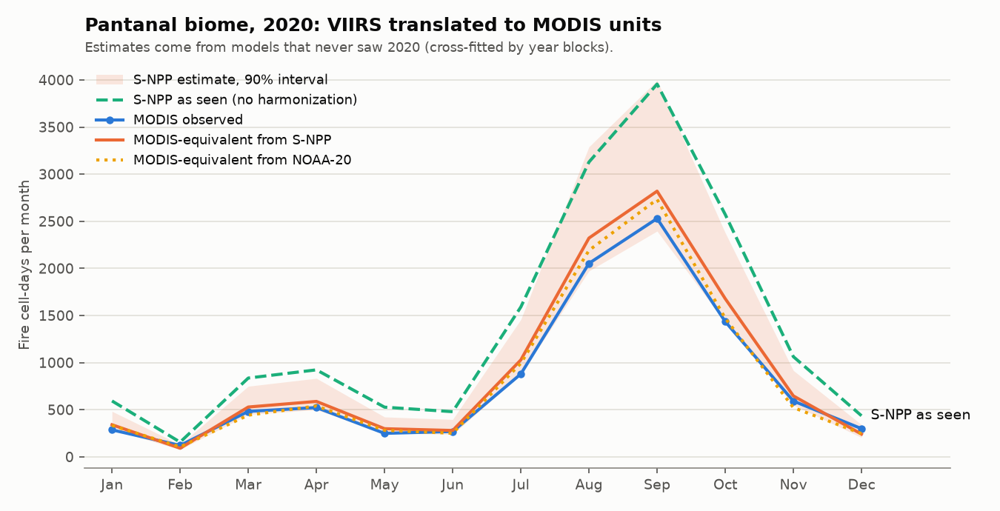
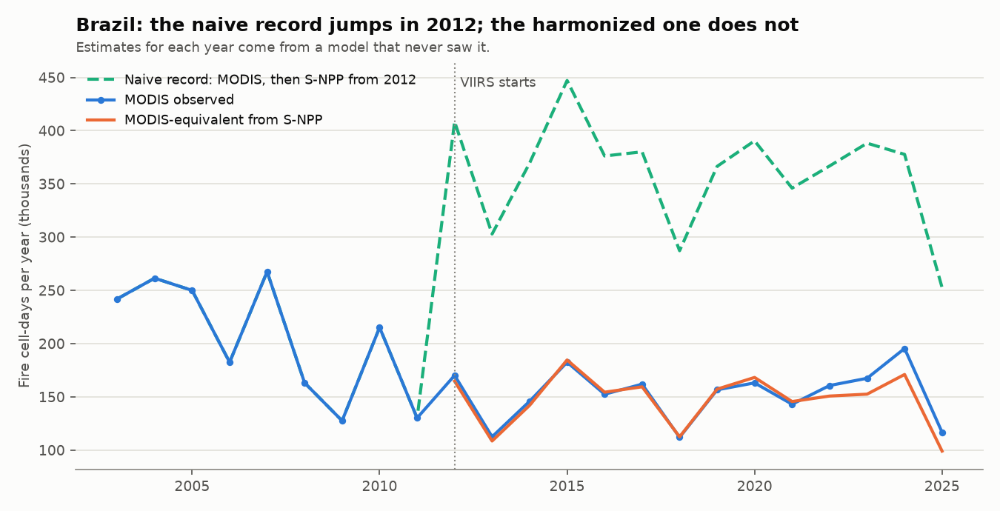

<!-- SI-assisted: written with Claude (Anthropic), reviewed by the Space Monkeys team. See README. -->

# Methodology: a harmonized MODIS/VIIRS burning activity record

This document explains how the Space Monkeys backend turns NASA active fire hotspots into a burning activity calendar, and why each choice was made. The commands, file layouts and full score tables are in the [README](../README.md); the exact meaning of every number the API returns is in the [API contract](api/openapi.yaml). Every number quoted here comes from the FIRMS archive (Brazil and the Pantanal, 2000-11-01 to 2026-11-14) as processed by the code in `pipeline/` and `app/history/`.

## 1. The question

For an area someone selects (a box, a biome or a drawn polygon), the calendar answers three questions:

1. **Seasonal pattern.** When does the fire season start, peak and end, and how does a given year compare with the normal season?
2. **Anomaly.** Is this week, month or season above or below normal for these calendar dates?
3. **Long-term trend.** Is burning activity going up or down over the years?

All three compare years with each other. They only work if a fire counted in 2005 and a fire counted in 2025 are counted the same way. That is the harmonization problem.

## 2. What a hotspot is, and why the raw record cannot be used as it is

A hotspot is the centre of a satellite pixel that the fire algorithm flagged as anomalously hot during one overpass. It is not a count of fires and not burned area. One large fire can light up many pixels; a small fire can be missed; a fire under cloud is not seen at all.

Two sensor families cover the period:

| Sensor | Satellites | Pixel | Record |
| --- | --- | --- | --- |
| MODIS (Collection 6.1) | Terra, Aqua | ~1 km | Terra from 2000-11-01, Aqua from 2002-07-04 |
| VIIRS 375 m (Collection 2) | S-NPP, NOAA-20, NOAA-21 | ~375 m | S-NPP from 2012-01-20, NOAA-20 from 2018-04-01, NOAA-21 from 2023-03-01 |

VIIRS sees small fires that MODIS misses, and splits one fire into more pixels. Both effects inflate counts. A naive record that uses MODIS until 2012 and VIIRS after it more than doubles in 2012. Over Brazil, counting what VIIRS sees as if it were MODIS overstates MODIS fire cell-days by 145% (Section 7). That step is an artefact of the sensors, not a change in fire, and it would dominate any trend.

The bridge has to be built now. MODIS is ending (NASA projects the end of its science data in 2027), and its orbits are already drifting (Section 5). The record can only continue on VIIRS. The years when both sensors observed the same fires are the only window to learn how a VIIRS observation translates into "what MODIS would have recorded".

**Our choice:** keep MODIS as the unit of the record, because it is the only sensor that covers the 20+ years needed for a normal and a trend, and express VIIRS in MODIS-equivalent units.

## 3. Data

All detections come from the NASA FIRMS archive download, standard processing:

- MODIS C6.1 standard active fire locations (`MCD14ML`), Terra and Aqua.
- VIIRS 375 m standard active fire product, Collection 2: S-NPP (`VNP14IMGTML`), NOAA-20 and NOAA-21.
- The recent months that standard processing has not reached yet come as near-real-time (NRT) files. They are kept but flagged, and they are never used to train or calibrate anything. Calendar buckets that include them are marked `provisional`.

Biome labels come from the IBGE "Biomas do Brasil 2019" map at 1:250,000. Full citations and licences are in the README's Data sources section.

Cleaning (`pipeline/ingest.py`):

- **Confidence.** Keep nominal and high confidence for both sensors (MODIS 30–100, VIIRS `n`/`h`).
- **Static heat sources.** Drop every detection within ~1 km of a location that VIIRS labels as a volcano or a static land source (FIRMS `type` 1 or 2). The same mask is applied to every sensor, so the sensors are filtered alike. MODIS `type` 2 labels are not used for the mask: in the Pantanal they are scattered and peak in the fire season, like vegetation fires.
- **Offshore.** FIRMS `type` 3 ("offshore") is kept: in the Pantanal these are fires on the seasonal wetland water mask.

Areas: a pilot box over the Pantanal (west −60, south −22.5, east −54.5, north −15) and a national box over Brazil (west −74.5, south −34.5, east −28.5, north 6). The models are trained and scored on cells whose centre falls inside a Brazilian biome.

## 4. The base unit: the fire cell-day

Raw pixel counts depend on pixel size, so they cannot be compared between sensors. The record counts **fire cell-days**:

- The grid has **0.1° cells** (about 11 km). Days are **UTC days**.
- A cell has a fire-day for a satellite if that satellite made at least one detection in the cell that day.
- An area's value for a period is the number of (cell, day) pairs with fire in it.

Satellites are combined with a logical **OR** on the cell-day, never a sum. A cell seen burning by both Terra and Aqua on the same day is one MODIS fire cell-day, not two. Pixel counts, fire radiative power (FRP) and day/night counts are kept, but only as model inputs.

The cube (`pipeline/cube.py`) has one row per cell, UTC day and satellite with at least one detection. The VIIRS satellites are **kept apart on purpose**. In the Pantanal, P(MODIS | any VIIRS) drops from about 0.37 to 0.26 when NOAA-20 joins in 2018, while P(MODIS | S-NPP) shows no break. For example, for cell-days with 4–9 S-NPP pixels, P(MODIS) is 0.60 in 2012–2017, 0.59 in 2018–2022 and 0.57 in 2023–2026. A growing VIIRS constellation makes "VIIRS combined" non-stationary, while one VIIRS satellite on a fixed orbit is stable. So each VIIRS satellite gets its own model.

**Days a satellite was not looking.** FIRMS records detections, not observations, so a day when a satellite was down reads as "no fire anywhere". A day is called a gap for a satellite when it has no detection in the whole region while the other satellites together have at least 100 fire cell-days (`pipeline.cube.observation_gaps`). In Brazil this finds 52 days for S-NPP (15 in July–August 2022, 19 in the 2024 fire season), 6 for NOAA-20, 38 for Terra and 27 for Aqua since 2000. MODIS gap days are left out of training, calibration and the coverage gap. On S-NPP gap days the served estimate comes from NOAA-20. Every gap is listed in `known_gaps` of `GET /history/meta`.

## 5. The reference: MODIS while its orbits were stable (2012–2021)

Terra and Aqua are drifting. The median local solar time of their daytime detections over Brazil, from the FIRMS archive:

| | 2012–2020 | 2022 | 2023 | 2024 | 2025 | 2026 |
|---|---|---|---|---|---|---|
| Terra | 10:26 | 10:13 | 10:00 | 9:40 | 9:14 | 8:50 |
| Aqua | 13:40 | 13:44 | 13:56 | 14:21 | 14:56 | 15:30 |
| S-NPP, NOAA-20 | 13:37 | 13:37 | 13:38 | 13:37 | 13:38 | 13:42 |

Fire activity has a strong daily cycle, so a sensor that looks at another hour sees a different amount of fire. From 2022 MODIS is no longer the instrument that measured the first 20 years of the record. Everything that defines "MODIS-equivalent" (training, calibration, coverage gap and interval) therefore uses only **2012–2021** (`REFERENCE_LAST_YEAR` in `pipeline/harmonize.py`).

The first sign was in the test scores. The calibrated national totals of LightGBM went from +6.3% (2018) to −7.1% (2024), about −2 points per year, and the U-Net drifted the same way (Section 7). When two different models drift together, the cause is in the data. The orbit table above confirmed it.

## 6. The calibration problem

The model answers one question per cell-day:

> Did MODIS (Terra or Aqua) detect fire in this 0.1° cell on this UTC day?

The answer is a probability, and it is predicted **only from what one VIIRS satellite saw**, plus context. No feature uses MODIS, because MODIS will not exist when the model is used.

**Which cell-days are rows.** A cell-day is a row when the VIIRS satellite saw fire in the cell's 3×3 neighbourhood that day or the day before. This is the same rule that inference will use after MODIS ends: the model can only run where VIIRS shows activity. Negative rows (VIIRS saw fire, MODIS did not) are what teach the model to discount VIIRS.

**Features** (`pipeline/training.py`):

- own cell, same day: VIIRS pixels, FRP sum and max, day, night and high-confidence pixels, overpasses, mean scan size;
- neighbours, same day: pixels and cells with fire in the 3×3 ring and in the 5×5 ring around it;
- previous days: own pixels on day −1 and days −2 to −3, neighbour pixels on day −1;
- context: month, day of year (sine and cosine), cell centre.

**The coverage gap.** Some MODIS fire-days have no VIIRS fire nearby, so they can never be rows. Inside the rows we find 74–90% of MODIS fire-days per year in the Pantanal, and 82% for Brazil (70% in the Pampa, 91% in the Pantanal biome). The missing ones are mostly small, short daytime fires (in the Pantanal, 81% are a single MODIS pixel, with median FRP 15 MW against 37 MW overall). They are mostly seen by Terra at about 10:30 local time, before the VIIRS pass at about 13:30. No row-based model can recover them, so the totals are corrected for them separately (Section 8, step 3).

**Class imbalance.** Most rows are negatives. The positive class is weighted by n_negative / n_positive in the loss. The weight multiplies the predicted odds, so the odds are divided back afterwards, and an isotonic calibration on a held-out year makes the probabilities honest.

**Time split only.** Train on early years, test on later ones, never a random split. Neighbouring days of the same fire are almost the same example, and a random split would leak them between train and test.

## 7. Models compared

All models are scored on the same rows of the same test years with the same metrics. The calendar shows totals, so the main metrics are on totals:

- **bias:** sum of predicted probabilities against the count of MODIS fire-days;
- **monthly WAPE:** weighted absolute percentage error of monthly regional totals (the headline number);
- **cell-month WAPE:** the same for each cell and month, to show how much worse small areas are;
- ROC AUC and average precision for the ranking of cell-days.

**1. Naive (no harmonization).** VIIRS saw fire, so MODIS would have. This is what the 2012 step looks like.

**2. Ratio.** The share of MODIS fire in the training years per month, for cells with and without their own VIIRS detection. This is the simplest correction.

**3. LightGBM** with every feature above, positive class weighted, early stopping and isotonic calibration on the last training year (held out, never refit on).

**4. U-Net** (`pipeline/unet.py`), our bet. It sees the whole Brazil grid as an image (416 × 464 cells). It has eight channels per day for days t−3 to t: log pixels, FRP sum and max, day, night and high-confidence pixels, overpasses and scan size. Day of year and cell position are added. LightGBM's lags also reach day t−3, so the only difference is space: the U-Net learns its own neighbourhood instead of the 3×3 and 5×5 summaries. It has 1.9 M parameters and a weighted BCE loss (positive weight 24.7). The loss counts exactly the candidate rows of the training table (checked: 0 rows of difference out of 26 million). It was trained on 2012–2016, with 2017 held out to choose the epoch and fit the isotonic calibration.

**Pantanal box, S-NPP, test 2018–2026:**

| Model | Bias | Monthly WAPE | Cell-month WAPE | ROC AUC | Avg. precision |
|---|---|---|---|---|---|
| naive | +103.8% | 103.8% | 114.3% | 0.890 | 0.361 |
| ratio | −13.0% | 20.3% | 75.1% | 0.905 | 0.432 |
| **LightGBM** | **+3.7%** | **5.6%** | **48.9%** | **0.950** | **0.720** |

**Brazil, S-NPP, test 2018–2026 (Brazil cells):**

| Model | Bias | Monthly WAPE | Cell-month WAPE | ROC AUC | Avg. precision |
|---|---|---|---|---|---|
| naive | +180% | 180% | — | — | — |
| LightGBM, calibrated | −0.5% | 6.9% | 69.6% | 0.900 | 0.494 |
| **U-Net, calibrated** | −1.7% | **6.5%** | **69.2%** | **0.909** | **0.496** |

What we learned:

- **Harmonization matters more where fires are small.** No correction overstates MODIS by +85% in the Pantanal, where fires are large, and by +180% nationally.
- **Fire strength is most of the signal.** About 70% of LightGBM's gain comes from VIIRS FRP: MODIS misses weak fires, and FRP measures how strong a fire is.
- **A model does not transfer across biomes.** The model trained in the Pantanal box still ranks cell-days well elsewhere (ROC AUC 0.83–0.88), but under-predicts every other biome by about half. The same VIIRS signal means a higher chance of a MODIS detection in the Pantanal, where fires are bigger. The harmonization has to be trained on the whole country and calibrated per biome.
- **The U-Net is slightly better, not much better.** Its monthly error is lower in every biome and it helps most where LightGBM was weakest (Pantanal bias +6.3% → +1.8%, Caatinga −10.8% → −7.8%). But the gain is 0.4 points of monthly error nationally, small next to the post-2021 drift. The wider spatial context adds little on top of the neighbourhood summaries.

**Decision.** The harmonized record uses **cross-fitted LightGBM with per-biome calibration**. Putting the U-Net in the record would mean cross-fitting it too (five folds, about 5 GPU hours) for a gain smaller than the uncertainty we already carry. The U-Net comparison stays in the repository as evidence.

## 8. Building the harmonized record

`pipeline/harmonize.py` produces, for every cell-day since 2012, the expected number of MODIS fire cell-days given what one VIIRS satellite saw. This is done for S-NPP and for NOAA-20.

1. **Cross-fitting over the reference years.** The reference years are split into blocks (S-NPP: 2012–14, 2015–17, 2018–19, 2020–21; NOAA-20: 2018–19, 2020–21). Each block is predicted by a LightGBM trained on the other blocks only, so every reference cell-day gets an out-of-sample estimate. The years after 2021 are predicted by one final model trained on every reference year. That is a forward prediction, as it will be after MODIS ends. NOAA-21 never overlapped the reference MODIS, so it is not calibrated.
2. **Calibration per biome.** An isotonic map from the out-of-fold probability to the observed MODIS rate, one per IBGE biome. One national map left the Pantanal 6% high and Caatinga and Pampa 11–13% low.
3. **Coverage gap.** Per biome and calendar month, g = (all MODIS fire-days) / (MODIS fire-days inside the rows), over the reference years. Each calibrated probability is multiplied by g, so an area's estimate is Σ p × g: an expected count of MODIS fire cell-days, not an integer. In the wet season g can be large (up to 5 in the Cerrado in March). There, most of the estimate is the gap, not what VIIRS saw. The gap cannot be placed on a map: per cell it is spread over the cells where VIIRS saw activity.
4. **90% interval.** Per biome, the 5th and 95th percentiles of the relative error of reference monthly totals (actual / estimate − 1, months with at least 20 estimated fire-days) give the interval [est × (1 + q05), est × (1 + q95)].

**Out-of-fold scores on the reference years.** The bias is close to zero by construction, because calibration and gap are fitted on these rows, so the monthly error is the number to read:

| Area | Monthly WAPE, S-NPP | Monthly WAPE, NOAA-20 | Naive VIIRS (bias) | 90% band, monthly (S-NPP) |
|---|---|---|---|---|
| Brazil | 3.7% | 6.3% | +145% | — |
| Cerrado | 4.9% | 6.8% | +118% | −21% / +52% |
| Amazon | 5.4% | 9.4% | +145% | −17% / +38% |
| Atlantic Forest | 5.7% | 8.1% | +202% | −14% / +15% |
| Caatinga | 5.9% | 7.4% | +210% | −21% / +16% |
| Pantanal | 9.8% | 8.5% | +79% | −15% / +42% |
| Pampa | 14.1% | 15.3% | +236% | −29% / +49% |

## 9. Validation

**Pantanal 2020** is the validation season chosen by the team. It is scored by models that never saw 2020: its block (2020–21) is predicted by models trained on the other blocks. The S-NPP estimate is within ±25% of MODIS every month, and +11% to +13% at the August–September peak. NOAA-20 tracks it closely. S-NPP as seen, without harmonization, is 29% to 112% above MODIS depending on the month.

**The 2012 step is gone.** Over Brazil, the MODIS-equivalent estimate follows observed MODIS year by year from 2012 to 2021 (yearly error between −3.5% and +3.1%).

**After the reference years**, the served estimate (S-NPP, NOAA-20 on S-NPP gap days) falls further below observed MODIS each year:

| | 2012–2021 | 2022 | 2023 | 2024 | 2025 |
|---|---|---|---|---|---|
| Estimate vs observed MODIS, Brazil | −3.5% to +3.1% | −0.8% | −8.3% | −8.4% | −15.1% |

This difference is not a model error. It mixes the model's forward error with the change in MODIS itself, and we have not measured how much is each. The timing matches the orbit drift: Aqua moving towards the afternoon peak of fire activity would raise its counts.

## 10. The calendar analytics

The API never runs a model. The pipeline writes one serving table (`pipeline/serving.py`) with, per cell-day, the observed MODIS and VIIRS flags and the VIIRS estimate. `app/history/` sums it with DuckDB for the requested area and computes the analytics on the daily totals (`app/history/analytics.py`).

**Three series.**

- `modis`: observed MODIS fire cell-days (Terra OR Aqua).
- `viirs`: observed fire cell-days from any VIIRS satellite. This is shown on the calendar and the map, but it steps up when NOAA-20 (about +50% fire cell-days over S-NPP alone) and NOAA-21 (about +80%) join. The routes that compare years refuse it (HTTP 422).
- `harmonized` (default): observed MODIS while MODIS delivers data, and before the switch date if one is set; the VIIRS MODIS-equivalent estimate after that. Each calendar bucket says which source it used (`modis`, `viirs_estimate` or `mixed`). Its interval is zero-width on MODIS days. On estimate days it is the biome's monthly band, weighted by the area's biome shares.

A missing value is not zero: outside a series' coverage the API returns no value.

**Weeks.** Week 1 is 1–7 January, week 2 is 8–14 January, and so on. The last week runs to 31 December (8 or 9 days), so every year has the same 52 weeks and the same dates fall in the same week every year.

**Normal year (climatology).** For each week or month, the median, the 10th and 90th percentiles and the mean over the base years. Only complete years count (every day has data). The default base runs from 2003, the first full year with both Terra and Aqua, to the last complete year. At least 3 base years are needed.

**Anomaly.** The total of the requested period is compared with the totals of the same calendar dates in every base year, leaving out the period's own year(s). The API returns the percentile (share of base years below the value) and a class:

- `record`: above every base year;
- `above`: above the 90th percentile;
- `below`: below the 10th percentile;
- `normal`: otherwise.

Percentiles are used rather than z-scores because they make no assumption about the shape of the distribution of yearly totals.

**Season.** The start is the first week by which 10% of the year's fire cell-days had happened, the peak is the week with the most, and the end is the first week by which 90% had happened. The normal season is the median of those weeks over the other complete base years.

**Trend.** Yearly totals over complete years and a Theil–Sen slope with its 95% confidence interval. The trend is called significant only when the interval excludes zero. Theil–Sen is the median of all pairwise slopes, so one extreme fire year cannot swing it the way it would swing a least-squares line.

## 11. Uncertainty and limitations

- **Small areas are much less certain than large ones.** Monthly error is 5–14% for a biome (S-NPP, reference years), but cell-month error is about 40–120% (test years, Section 7). The served interval is calibrated at the biome-month scale: it is too narrow for small areas and not valid for yearly totals (monthly errors partly cancel). Scale-aware intervals are not done yet.
- **Normals and trends that include 2022 onwards include drifted MODIS.** While MODIS still delivers data, the harmonized series is observed MODIS, so these years enter the default base period and the trend as observed. Section 9 suggests this raises recent counts.
- **No clear-sky record.** FIRMS lists detections, not observations. A cloudy day and a day with no fire look the same, for every sensor alike. Satellite outages are detected only when they are region-wide (Section 4).
- **Static sources.** The static-source mask comes from VIIRS labels. Industrial heat sources not labelled by FIRMS remain in the record.
- **Coverage outside Brazil.** The estimate exists only in cells of a Brazilian biome. A box over Bolivia or Paraguay would lose that part after a switch to the estimate.
- **The two VIIRS satellites disagree in 2025.** The estimate is −15.1% from S-NPP and −8.9% from NOAA-20 alone. S-NPP has no gap day in 2025, so this is not explained yet. NOAA-20 has only 2018–2021 as reference, so its model is the noisier of the two.
- **Hotspots are not burned area.** The record measures how often fire was detected in a cell, not how much land burned.

## 12. Open decisions

- **When the harmonized series switches from MODIS to the VIIRS estimate.** Today the switch happens only when MODIS stops delivering data. Switching on 2022-01-01 (`python -m pipeline.serving brazil --switch-date 2022-01-01`) would remove the orbit drift from recent normals and trends. Two things are missing first:
  - the estimate stops on the last day with standard-processing data (2026-07-31), so the months after it would be empty;
  - after MODIS ends the training table cannot be built, because it needs MODIS dates. The final model exists; running it on VIIRS-only days is the next step.
- **NOAA-21.** It never overlapped stable-orbit MODIS, so it is not calibrated. S-NPP ended on 2026-11-02, which leaves NOAA-20 as the only calibrated VIIRS satellite. How to bring NOAA-21 in (for example through its overlap with NOAA-20) is not decided.

## 13. The real-time layer (not part of the harmonization)

The backend also serves a live map (`app/realtime/`, `app/fusion/`). It merges GOES-East and FIRMS NRT detections of the same fire into one event. Its combined confidence, 1 − ∏(1 − c) over the best confidence per sensor, treats sensor confidences as calibrated, independent probabilities. They are neither, so it is a heuristic for ranking live events, not a probability. The live layer does not feed the historical record. The fire forecast model (`notebooks/fire_forecast_base.ipynb`, `/forecast`) is described in the README.

## References

- Giglio, L., Schroeder, W., Justice, C. O. (2016). The collection 6 MODIS active fire detection algorithm and fire products. *Remote Sensing of Environment*, 178, 31–41. https://doi.org/10.1016/j.rse.2016.02.054
- Schroeder, W., Oliva, P., Giglio, L., Csiszar, I. A. (2014). The New VIIRS 375 m active fire detection data product: Algorithm description and initial assessment. *Remote Sensing of Environment*, 143, 85–96. https://doi.org/10.1016/j.rse.2013.12.008
- Data products, DOIs, licences and software: see the README's Data sources and Software sections.
